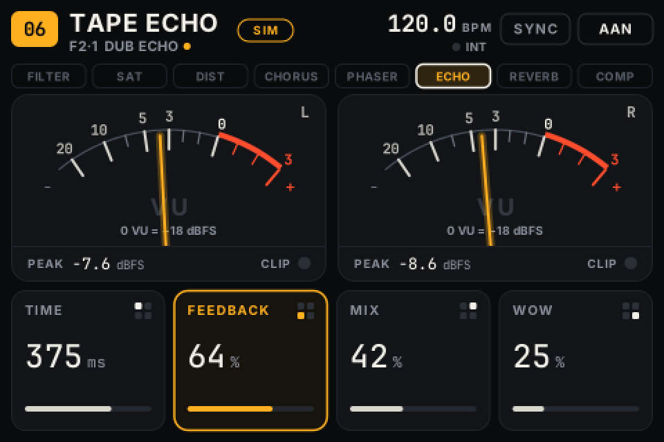

# FXBox

**English** · [Nederlands](README.nl.md)

FXBox turns a Zynthian Kit V4 (Raspberry Pi 4) into a standalone multi-effect unit for external instruments. The device does not need the Zynthian software, nor a computer, browser or internet connection while you play.

```
instrument → input → Filter → Saturation → Distortion → Chorus → Phaser → Tape Echo → Reverb → Compressor → output
```

- **Effects:** eight effects in a fixed chain, each switchable on or off. Filter (5 types, LFO with 4 shapes, envelope), Saturation, Distortion (5 types, 2× oversampling), Chorus, Phaser, Tape Echo, Reverb and a Compressor with limiter at the end. Filter, Distortion and Compressor have a second page of settings. The input can be mono or stereo; the output is always stereo.
- **Controls:** the four rotary encoders belong to the four tiles on the screen; S1–S4 select presets and banks. No touchscreen needed.
- **Meters:** two analogue-style VU needles that follow the real output signal, with separate dBFS peak and clip detection.
- **Tempo:** MIDI clock via DIN or USB, with tap tempo and musical divisions (dotted and triplet).
- **Presets:** 44 factory presets in 7 banks and 32 slots for your own presets. After boot, the last state is restored.

> The on-device interface is in Dutch. The [manual](docs/MANUAL.md) shows each on-screen label as it appears, with its English meaning.



## Folders

| Folder | Contents |
|---|---|
| `engine/` | C++ audio engine (JACK), effects in Faust (`dsp/`, generated C++ in `dsp/generated/`), tests |
| `ui/` | interface (Python + cairo): controller, renderer, framebuffer, MCP23017, desktop demo, tests |
| `presets/` | factory presets (`factory.json`) |
| `config/` | hardware and audio settings (installed to `/etc/fxbox/`) |
| `system/` | systemd services and the ZynScreen overlays |
| `install/` | install, uninstall, boot configuration, mixer, latency measurement |
| `docs/` | manual, architecture, hardware and sources, test report |

## Getting started

- **On the device:** see [docs/MANUAL.md](docs/MANUAL.md). In short: write Raspberry Pi OS Lite 64-bit (Bookworm) to a card, run `sudo ./install/install.sh` and reboot.
- **Ready-made image:** `sudo ./install/build-image.sh --user NAME --xz` builds a flashable `.img` with FXBox included, on a Linux PC (manual §3b).
- **Desktop demo** (Linux or macOS, Python 3.11 or newer):

```bash
pip install -r requirements-desktop.txt
cd ui && python3 -m fxbox.demo
```

The demo runs the real interface code. Meters, tempo and MIDI clock are **simulated** and no audio is processed; the screen shows this with a "SIM" label. To use a real engine on JACK, pass `--engine /path/to/engine.sock`.

- **Build and test the engine (Linux):**

```bash
sudo apt install cmake g++ pkg-config libjack-jackd2-dev libasound2-dev
cmake -S engine -B engine/build && cmake --build engine/build -j
engine/build/test_dsp && engine/build/test_tempo
```

## Documentation

- [Manual](docs/MANUAL.md): installation, operation and recovery
- [Architecture](docs/ARCHITECTURE.md): technical choices and specified behaviour
- [Hardware](docs/HARDWARE.md): connections, settings and sources
- [Test report](docs/TEST_REPORT.md): what has been tested and what still needs checking on the device

## License

GPL-3.0-or-later (see `LICENSE`).

- The ZynScreen overlays in `system/overlays/` come from [zynthian-sys](https://github.com/zynthian/zynthian-sys) (GPL-3.0).
- The effects are built with the Faust libraries (LGPL with an exception for generated code).
