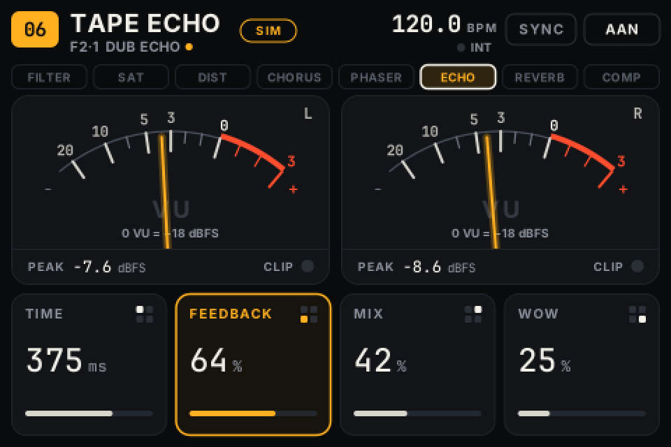

# FXBox

[English](README.md) · **Nederlands**

FXBox maakt van een Zynthian Kit V4 (Raspberry Pi 4) een zelfstandige multi-effectbak voor externe instrumenten. Het toestel heeft geen Zynthian-software nodig, en ook geen computer, browser of internet tijdens het spelen.

```
instrument → ingang → Filter → Saturation → Distortion → Chorus → Phaser → Tape Echo → Reverb → Compressor → uitgang
```

- **Effecten:** acht effecten in een vaste keten, elk aan of uit. Filter (5 types, LFO met 4 vormen, envelope), Saturation, Distortion (5 types, 2× oversampling), Chorus, Phaser, Tape Echo, Reverb en een Compressor met limiter aan het einde. Filter, Distortion en Compressor hebben een tweede pagina met instellingen. De ingang kan mono of stereo zijn, de uitgang is altijd stereo.
- **Bediening:** de vier draaiknoppen horen bij de vier tegels op het scherm; met S1–S4 kies je presets en banken. Een touchscreen is niet nodig.
- **Meters:** twee analoge VU-naalden die het echte uitgangssignaal volgen, met aparte dBFS-piek- en clipdetectie.
- **Tempo:** MIDI-clock via DIN of USB, met tap tempo en muzikale verdelingen (gepunt en triool).
- **Presets:** 44 fabriekspresets in 7 banken en 32 plaatsen voor eigen presets. Na het opstarten staat de laatste toestand terug.



## Mappen

| Map | Inhoud |
|---|---|
| `engine/` | C++-audio-engine (JACK), effecten in Faust (`dsp/`, gegenereerde C++ in `dsp/generated/`), tests |
| `ui/` | interface (Python + cairo): controller, renderer, framebuffer, MCP23017, desktopdemo, tests |
| `presets/` | fabriekspresets (`factory.json`) |
| `config/` | hardware- en audio-instellingen (komen in `/etc/fxbox/`) |
| `system/` | systemd-diensten en de ZynScreen-overlays |
| `install/` | installatie, verwijderen, opstartconfiguratie, mixer, latentiemeting |
| `docs/` | handleiding, architectuur, hardware en bronnen, testrapport |

## Snel aan de slag

- **Op het toestel:** zie [docs/MANUAL.nl.md](docs/MANUAL.nl.md). Kort samengevat: Raspberry Pi OS Lite 64-bit (Bookworm) op een kaart zetten, `sudo ./install/install.sh` uitvoeren en herstarten.
- **Kant-en-klaar image:** `sudo ./install/build-image.sh --user NAAM --xz` bouwt op een Linux-pc een flashbaar `.img` met FXBox erin (handleiding §3b).
- **Desktopdemo** (Linux of macOS, Python 3.11 of nieuwer):

  ```bash
  pip install -r requirements-desktop.txt
  cd ui && python3 -m fxbox.demo
  ```

  De demo draait de echte interfacecode. Meters, tempo en MIDI-clock zijn daarin **gesimuleerd** en er wordt geen audio verwerkt. Dat staat ook in beeld (label "SIM"). Met een echte engine op JACK gebruik je `--engine /pad/naar/engine.sock`.

- **Engine bouwen en testen (Linux):**

  ```bash
  sudo apt install cmake g++ pkg-config libjack-jackd2-dev libasound2-dev
  cmake -S engine -B engine/build && cmake --build engine/build -j
  engine/build/test_dsp && engine/build/test_tempo
  ```

## Documentatie

- [Handleiding](docs/MANUAL.nl.md): installatie, bediening en herstel
- [Architectuur](docs/ARCHITECTURE.nl.md): technische keuzes en vastgelegd gedrag
- [Hardware](docs/HARDWARE.nl.md): aansluitingen, instellingen en bronnen
- [Testrapport](docs/TEST_REPORT.nl.md): wat getest is en wat nog op het toestel gecontroleerd moet worden

## Licentie

GPL-3.0-or-later (zie `LICENSE`).

- De ZynScreen-overlays in `system/overlays/` komen uit [zynthian-sys](https://github.com/zynthian/zynthian-sys) (GPL-3.0).
- De effecten zijn gebouwd met de Faust-bibliotheken (LGPL met uitzondering voor gegenereerde code).
