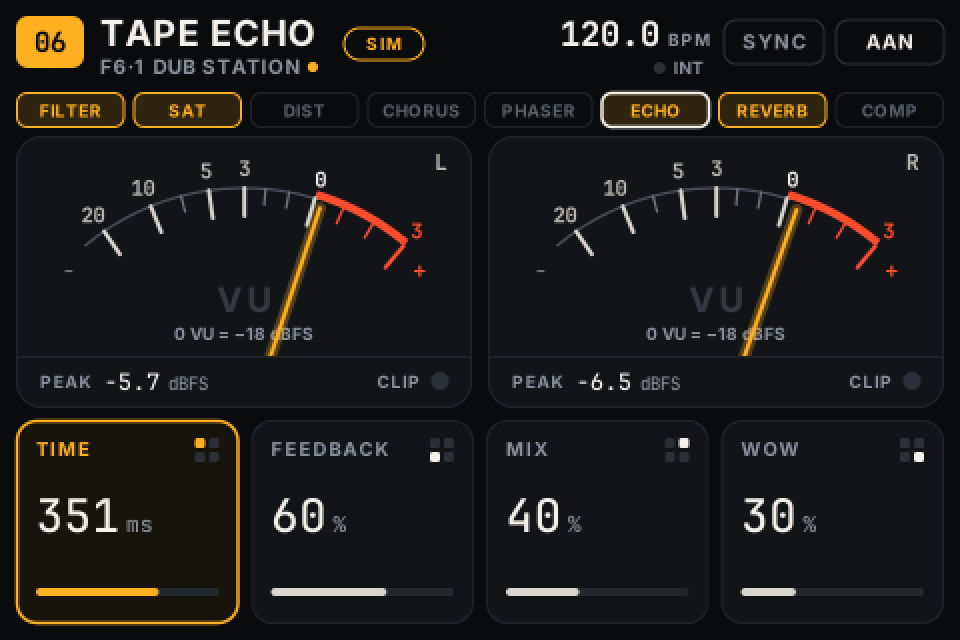
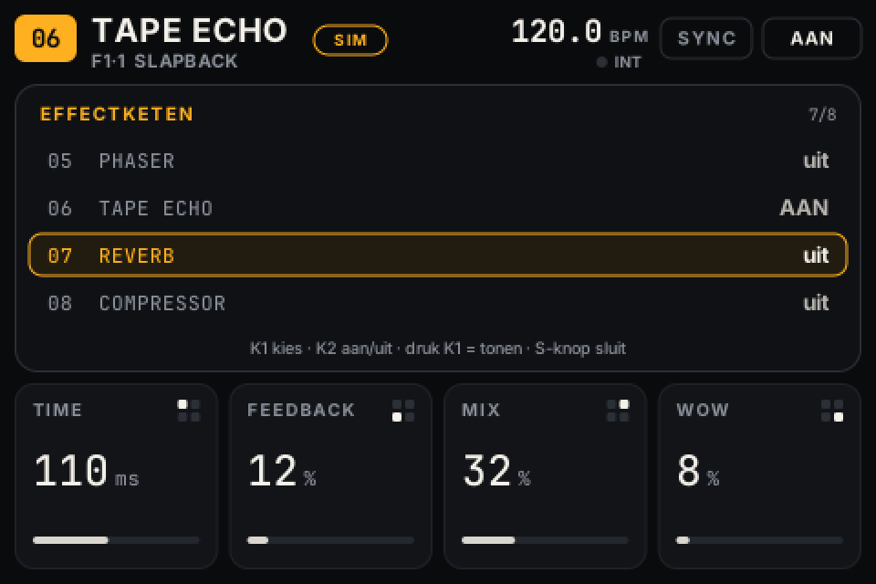
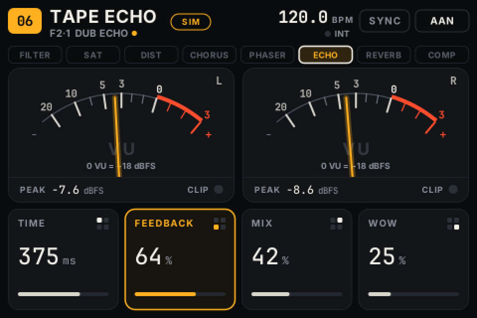
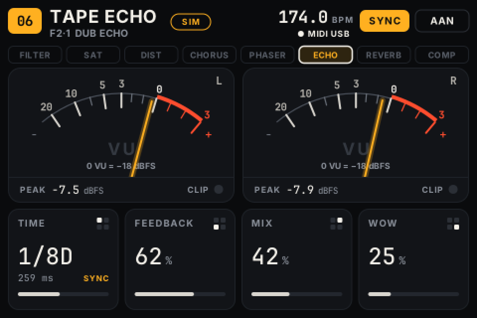
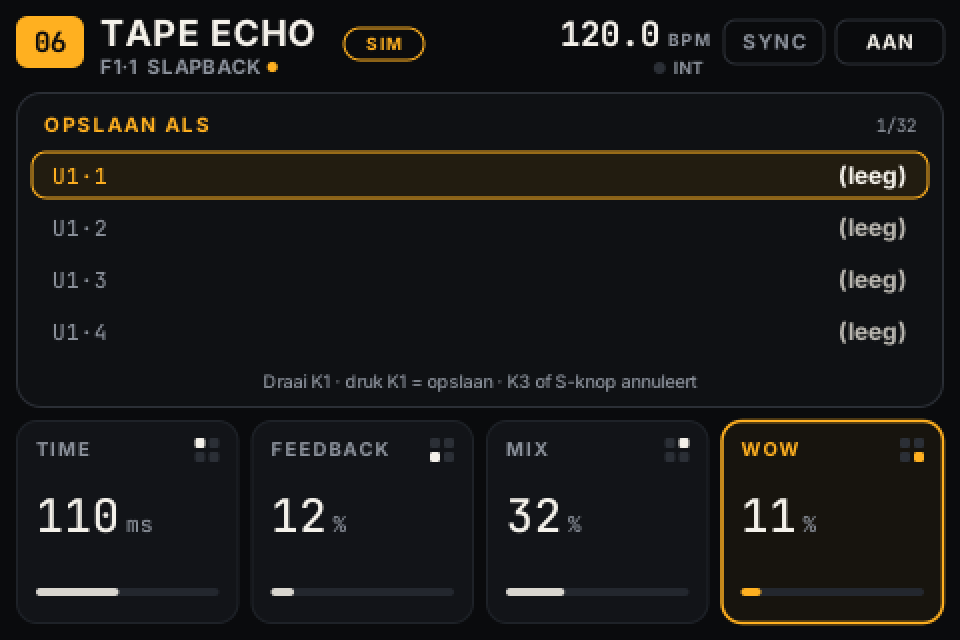
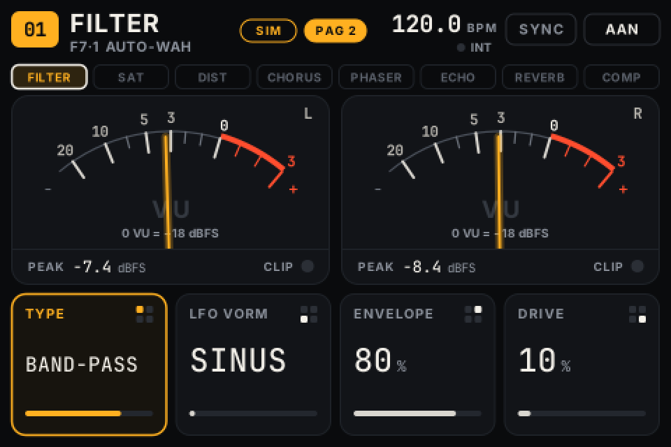
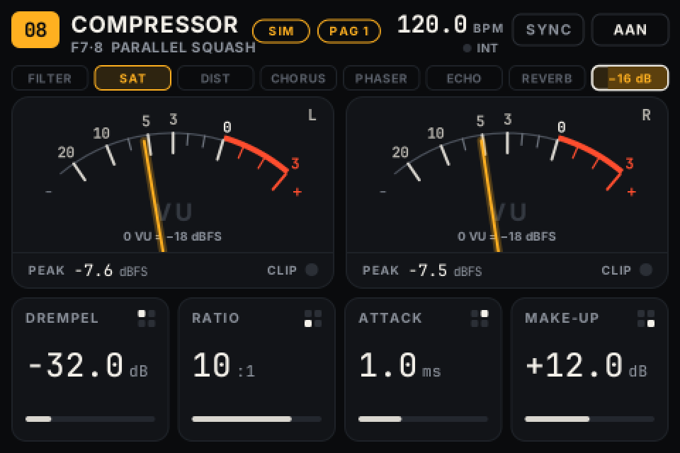
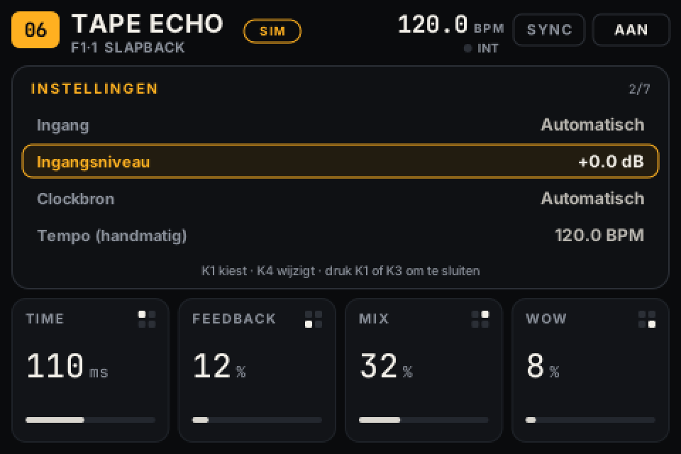

# FXBox — manual

**English** · [Nederlands](MANUAL.nl.md)

Switch on, plug in your instrument, choose a preset and play. This manual covers installation, operation and what to do when something goes wrong.

> **About the on-screen language.** The FXBox interface is in Dutch. In this manual, on-screen labels are shown as they appear on the device, followed by their English meaning, e.g. *Instellingen* (Settings).

## 1. What you need

- Zynthian Kit V4 with Raspberry Pi 4, ZynScreen, ZynADAC (or HiFiBerry DAC+ ADC Pro)
- A microSD card of at least 8 GB, which **will be erased**
- A computer with Raspberry Pi Imager and a network (only for installation)

## 2. Preparing the SD card

> **Caution:** Raspberry Pi Imager erases the selected card completely. Choose the right card; FXBox itself never writes to a card.

1. Open Raspberry Pi Imager → *Raspberry Pi 4* → *Raspberry Pi OS (other)* → **Raspberry Pi OS Lite (64-bit)** (Bookworm).
2. Under *Edit settings*: hostname `fxbox`, a user with password, **SSH on**, optionally Wi-Fi.
3. Write the card, put it in the Pi and start the device. The ZynScreen stays white or black for now; that is normal.

## 3. Installing

Copy the zip file to the Pi and install (from your computer):

```bash
scp fxbox-1.2.0.zip USER@fxbox.local:
ssh USER@fxbox.local
unzip fxbox-1.2.0.zip && cd fxbox
sudo ./install/install.sh
sudo reboot
```

The script installs the packages, builds the audio engine and runs the engine and interface tests on the Pi itself. Before it changes the boot configuration, it asks for confirmation; a backup copy of `config.txt` and `cmdline.txt` is kept. This takes a while, because packages are downloaded and the engine is compiled on the Pi.

After the reboot, the device starts straight into the effects interface.

### 3b. Alternative: build a ready-made image

With `install/build-image.sh` you build an `.img` file with FXBox already installed, on a Linux PC (Debian/Ubuntu). You then simply write it to a card; installing on the Pi itself is no longer needed.

```bash
sudo apt install curl xz-utils parted e2fsprogs openssl rsync qemu-user-static binfmt-support
sudo ./install/build-image.sh --user USER --hostname fxbox --xz
```

- The script downloads the latest Raspberry Pi OS Lite 64-bit "oldstable" (Bookworm) and verifies the SHA-256.
- With `--base FILE` you use an image you have already downloaded.
- The install script then runs under ARM64 emulation, including all tests. Expect a long build, because the engine compiles slowly under emulation.
- The result goes into `image-out/`: `fxbox-<version>-<date>.img` (plus `.xz` and `.sha256`), together with the installation log.
- User, password (hashed), SSH and hostname are already in the image.
- Write the image with Raspberry Pi Imager → *Use custom* and skip the *OS customisation* there.
- On first boot, Raspberry Pi OS enlarges the file system and reboots once. Then do the check in step 4.
- The script only creates a file and never writes to an SD card itself.
- If the "oldstable" download is no longer Bookworm by then, the script stops. Pass a Bookworm image with `--base`, or deliberately build with `--allow-trixie`.

## 4. First check (one-time)

```bash
sudo fxbox-hwtest check            # are screen, controls, sound card and MIDI UART present?
sudo systemctl stop fxbox-ui
sudo fxbox-hwtest screen           # test image: border visible all round, text upright
sudo fxbox-hwtest controls --write # press S1..S4, press and turn K1..K4 as asked
sudo systemctl start fxbox-ui
sudo ./install/measure-latency.sh  # optional: cable from OUT L to IN L, measures the delay
```

`controls --write` stores the measured control mapping in `/etc/fxbox/hardware.toml`.

## 5. Connecting

Instrument → **IN L** (mono) or **IN L + R** (stereo) → effect → **OUT L + R**.

- The input expects **line level** (synth, drum machine, mixing desk).
- For guitar or bass: use a DI box or a buffer/effects pedal in front. The input is not high-impedance.
- Mono in to stereo out happens automatically: with *Instellingen → Ingang* (Settings → Input) set to **Automatisch** (Automatic, the default), FXBox detects that IN R is silent and sends the left channel to both sides. Both VU meters then move and the right meter shows **R=L**. You can also fix the input to *Stereo* or *Mono (L)*.
- If **IN CLIP** or **CLIP** lights up, lower the level of your instrument or *Instellingen → Ingangsniveau* (Settings → Input level).

## 6. Operation

### The effect chain

FXBox works like a pedalboard with eight effects in a fixed order. Each effect is on or off:

**01 Filter → 02 Saturation → 03 Distortion → 04 Chorus → 05 Phaser → 06 Tape Echo → 07 Reverb → 08 Compressor**

- The bar above the meters shows the chain. Effects that are **on** are amber, effects that are off are grey. The effect with the white border is on screen: the four tiles and the encoders belong to *that* effect.
- Effects that are off cost no processing power.
- When the compressor is on, its box shows how much it is reducing the level at that moment (for example *−4 dB*). The dark fill grows with it, up to 20 dB.



### Controls

The four tiles at the bottom belong to the four encoders. The small 2×2 symbol at the top right of a tile shows which encoder it is.

| Control | Turn | Short press | Hold (0.8 s) |
|---|---|---|---|
| **K1** top left | parameter 1 | **chain screen**: choose an effect with K1, K2 switches it on/off, K1 shows it | **save** as user preset |
| **K2** bottom left | parameter 2 | shown effect **on/off** | **bypass** of the whole chain |
| **K3** top right | parameter 3 | **sync** on/off | **settings** |
| **K4** bottom right | parameter 4 | **tap tempo** | **page 1 / page 2** of the shown effect |
| **S1 / S2** | | previous / next preset | |
| **S3 / S4** | | previous / next bank | |

- While playing, turning always adjusts the matching parameter of the shown effect. Turning fast makes bigger steps.
- An encoder you press does not change a parameter, even if it turns slightly along with the press.
- Tap tempo reacts immediately on press. K2 reacts on release, so short (effect on/off) and long (whole-chain bypass) can be told apart.
- If the shown effect is off, **UIT** (OFF) appears next to its name. You can already adjust its settings before switching it on.
- In a selection screen, pressing S1–S4 closes or cancels.
- **Page 2:** Filter, Distortion and Compressor have a second row of four settings. Hold **K4** to switch; the header then shows **PAG 2** (amber). Choosing another effect or preset takes you back to page 1. Effects without a second page show *Geen pagina 2* (No page 2). Because K4 also gives a tap when pressed, that single tap only counts if you tap again within 2 seconds.
- **Choice parameters** such as TYPE and LFO VORM (LFO shape) move one step per click, however fast you turn.



| Effect | K1 | K2 | K3 | K4 |
|---|---|---|---|---|
| 01 Filter | Cutoff | Reso | LFO Rate | LFO Diepte (depth) |
| 01 Filter, page 2 | Type | LFO Vorm (shape) | Envelope | Drive |
| 02 Saturation | Drive | Warmte (warmth) | Mix | Level |
| 03 Distortion | Drive | Tone | Mix | Level |
| 03 Distortion, page 2 | Type | Crush | Gate | — |
| 04 Chorus | Rate | Depth | Mix | Feedback |
| 05 Phaser | Rate | Depth | Mix | Feedback |
| 06 Tape Echo | Time | Feedback | Mix | Wow |
| 07 Reverb | Decay | Tone | Mix | Predelay |
| 08 Compressor | Drempel (threshold) | Ratio | Attack | Make-up |
| 08 Compressor, page 2 | Release | Knee | Mix | Limiter |

- **Filter:**
  - *Type:* **Ladder LP** (4-pole, Moog style, as in version 1.1), **Low-pass**, **High-pass**, **Band-pass** and **Notch** (12 dB/octave, state-variable). Switching uses a short crossfade, without a click.
  - *LFO:* moves the cutoff up and down by up to 3 octaves and follows the tempo when sync is on. *LFO Vorm* (shape): sine, triangle, square or random (sample & hold, one new value per LFO period).
  - *Envelope:* the harder you play, the higher the cutoff (up to 4 octaves): an auto-wah. Try Band-pass with Envelope around 80 %.
  - *Drive:* lightly overdrives the signal before the filter (up to 18 dB, with volume compensation).
- **Saturation:** warm tape- or valve-like saturation. More Drive gives more harmonics and compression, but the volume stays roughly the same. *Warmte* (warmth) adds even harmonics and softens the highs a little.
- **Distortion:**
  - *Type:* **Overdrive** (soft, as in version 1.1), **Distortion** (hard clipping), **Fuzz**, **Bitcrush** and **Folder** (wavefolder: the signal folds back instead of being clipped, metallic and synth-like).
  - With Mix below 100 % you blend in the dry signal (parallel distortion). Level sets the effect's output volume.
  - *Crush* only works with Bitcrush: fewer bits and a lower sample rate.
  - *Gate* is a noise gate before the distortion, useful with Fuzz to keep noise out between notes. At 0 % it is off.
  - Internally the Distortion runs at double the sample rate (2× oversampling). This gives less aliasing, a harsh by-product on high notes. It does cost more processing power and adds 23 samples (0.5 ms) of delay, but only while the Distortion is on.
- **Compressor:** always last in the chain and keeps the final level under control.
  - *Drempel* (threshold): from which level (dBFS) it starts reducing. *Ratio:* how strongly (4:1 means 4 dB more above the threshold gives 1 dB more at the output). *Attack* and *Release:* how fast it reacts and lets go. *Knee:* how gradual the transition around the threshold is. *Make-up:* gain afterwards.
  - *Mix* below 100 % gives parallel compression: the uncompressed signal stays in.
  - *Limiter* (**on** by default) is a fast limiter after the compressor that keeps the output below about −1 dBFS, even with a lot of make-up gain. It only works when the compressor is on.

## 7. The screen



- **Top left:** effect number and name, below it bank·preset and the preset name. An amber dot means you have changed the preset but not saved it yet.
- **Top right:** tempo in BPM with its source underneath.
  - *MIDI DIN* or *MIDI USB* with a lit dot means clock really is coming in.
  - *TAP* or *INT* means manual tempo.
  - Also **SYNC** (amber = on) and **AAN/BYPASS** (ON/BYPASS).
- **Meters:** the needles show the output level on a **relative VU scale**; top left shows which digital level is 0 VU. **PEAK** is the digital peak in **dBFS** (0 dBFS is the converter's maximum). **CLIP** lights up when the output hits full scale.
- **Tiles:** name, value, unit and a small bar. The last adjusted parameter lights up amber. With sync on, a time or rate parameter shows a division such as 1/8D, with the calculated value underneath.



## 8. Presets

- **7 factory banks:** F1 Basis (Basic), F2 Dub & Space, F3 Ambient, F4 Modulatie (Modulation), F5 Drive & Filter and F6 Ketens (Chains: several effects at once) with 6 presets each, and F7 Karakter (Character) with 8 presets for the filter and distortion types and the compressor (Auto-wah, HP wobble, Sample & hold, Lo-fi crush, Wavefolder, Gated fuzz, Glue, Parallel squash). Factory presets cannot be overwritten.
- Presets and state from version 1.1 keep working. Where page 2 settings are missing, the defaults apply, which sound as in 1.1 (Ladder filter, Overdrive).
- A preset stores the whole chain: which effects are on, their settings and which effect is on screen.
- **Saving:** hold K1. Choose a slot in user banks U1–U4 (8 slots per bank) with K1 and press K1 to save. Cancel with K3 or S1–S4. If you were already editing a user preset, that slot is preselected, so saving again is: hold K1, then press K1.
- User banks appear in the bank selection as soon as they contain at least one preset.
- The device remembers the chain (on/off and all values), the shown effect, preset, bank, sync, bypass and settings, and starts in the same state after power-on.
- Changes are saved 2 seconds after you stop turning. So do not switch the device off within 2 seconds of a change you want to keep.







## 9. Tempo and MIDI sync

- **Sync off:** Time is in ms and Rate in Hz. **Tap** (K4) sets the Tape Echo Time to one quarter note of the tapped tempo.
- **Sync on:** Time and Rate follow the tempo, with divisions 1/32 … 1/1 for delay and 1/16 … 8/1 for modulation (D = dotted, T = triplet).
- **Tempo source:**
  - If MIDI clock is coming in (DIN or USB), FXBox follows it.
  - Otherwise the tapped or manual tempo applies (*Instellingen → Tempo*).
- **Clock lost:** the last tempo is kept and the dot next to the source goes out.
- **MIDI Start:** Chorus and Phaser start their movement on beat 1. **Stop** and **Continue** leave the sound untouched.
- **Several MIDI devices:** choose the source in *Instellingen → Clockbron* (Settings → Clock source).

## 10. Settings (hold K3)

Turn **K1** to choose an item and **K4** to change its value. Press **K1** or **K3** to close.

| Item (on screen) | Choices |
|---|---|
| Ingang (Input) | Automatisch (Automatic) / Stereo / Mono (L) |
| Ingangsniveau (Input level) | −12 … +12 dB (digital) |
| Clockbron (Clock source) | Automatisch (Automatic) / DIN-MIDI / USB device |
| Tempo (manual) | 30 … 300 BPM |
| Staarten bij bypass (Tails on bypass) | On: echo and reverb ring out when you switch off an effect or the whole chain. Off: silent immediately. |
| VU-referentie (VU reference) | 0 VU = −12 / −14 / −18 / −20 dBFS |
| Info | sample rate, buffer size, number of xruns, DSP load |



## 11. Troubleshooting and recovery

| Message on screen | What to do |
|---|---|
| *Geen audio-interface gevonden* (No audio interface found) | Switch the device off. Check that the sound card sits properly on the Pi's pins. The device keeps retrying. |
| *Audioserver niet actief* (Audio server not running) / *Audio onderbroken* (Audio interrupted) | Restarted automatically. If the message stays, run `sudo systemctl status fxbox-jack`. |
| *Audio-engine niet bereikbaar* (Audio engine unreachable) | After 10 crashes in 2 minutes, automatic restarting stops. Run `sudo systemctl restart fxbox-engine` and check `journalctl -u fxbox-engine -b`. |
| *Bediening niet gevonden (I²C 0x20)* (Controls not found) | The screen works, the controls don't. Check the connection of the ZynScreen board. Run `sudo fxbox-hwtest check`. |
| Encoder turns the wrong way, or S1–S4 in the wrong order | `sudo fxbox-hwtest controls --write`, or adjust `reverse` in `/etc/fxbox/hardware.toml`. |
| Crackles | *Instellingen → Info*: is the xrun count going up? Set `PERIOD=256` in `/etc/fxbox/audio.conf` and run `sudo systemctl restart fxbox-jack fxbox-engine`. |
| Screen stays white or black | Run `sudo fxbox-hwtest screen` and then `dmesg \| grep -i -E "fb\|ili"`. Is the FXBox block present in `/boot/firmware/config.txt`? |

**Maintenance via SSH.** The device runs without a desktop. You can always log in with `ssh USER@fxbox.local`. The text console is deliberately detached from all screens, HDMI included, so a login prompt or boot text never appears on the ZynScreen.

- Logs: `journalctl -u fxbox-ui -u fxbox-engine -u fxbox-jack -b`. These live in RAM and are gone after a reboot.
- **Reset settings to defaults:** `sudo systemctl stop fxbox-ui && sudo rm /var/lib/fxbox/state.json && sudo systemctl start fxbox-ui`.
- **Erase user presets:** delete `/var/lib/fxbox/user_presets.json`. Make a copy first if you want to keep them.
- **Updating:** unpack a new version and run `sudo ./install/install.sh` again. Your hardware and audio settings and your presets are kept.
- **Uninstalling:** `sudo ./install/uninstall.sh` restores the boot configuration. Use `--purge` to also erase presets and settings.
