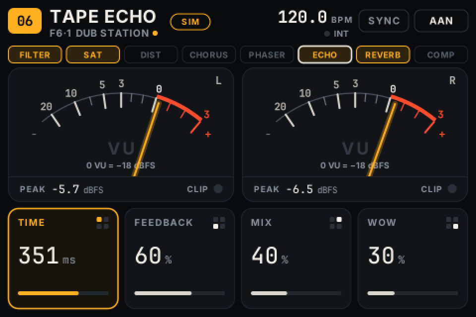
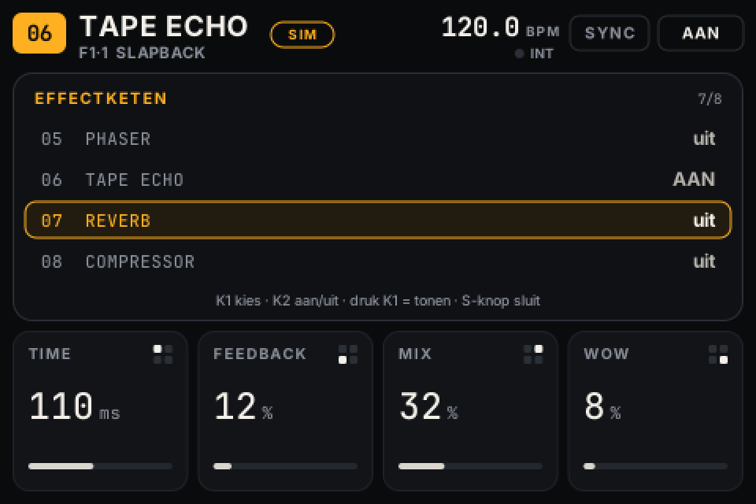
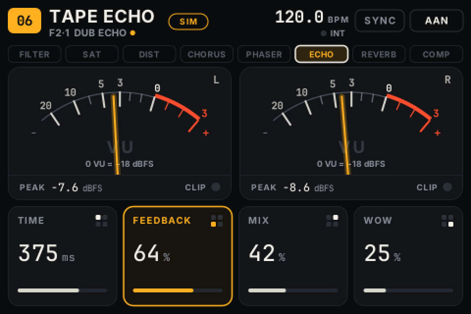
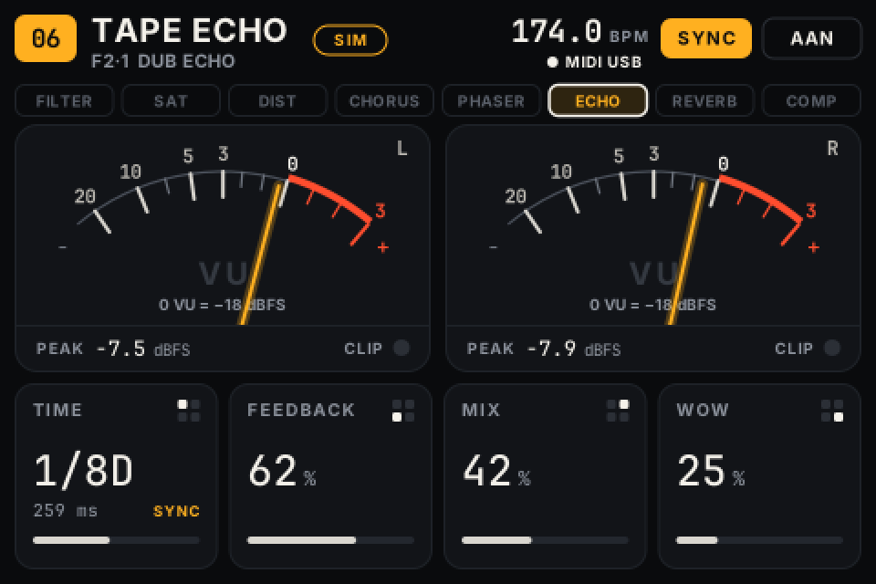
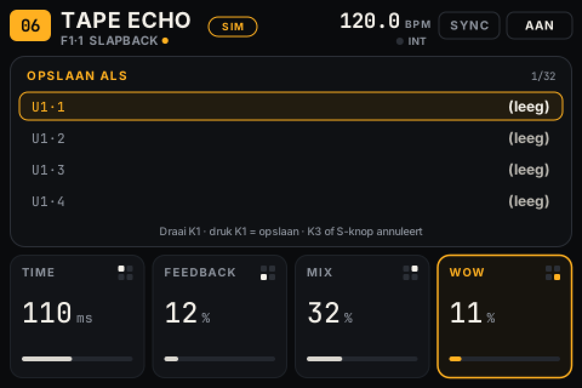
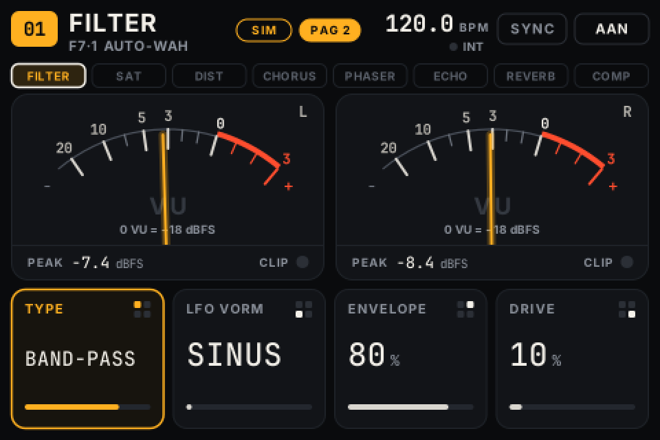
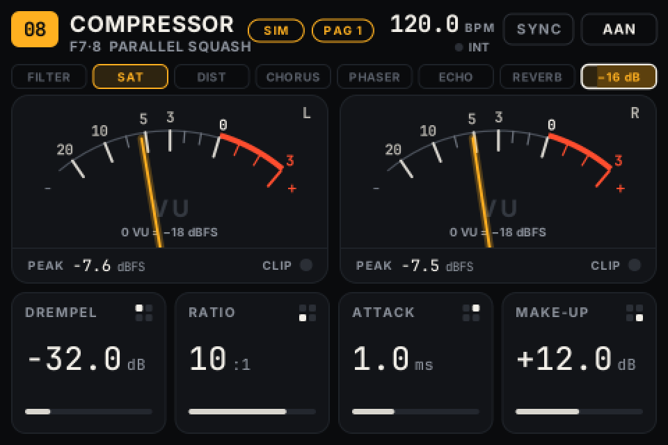
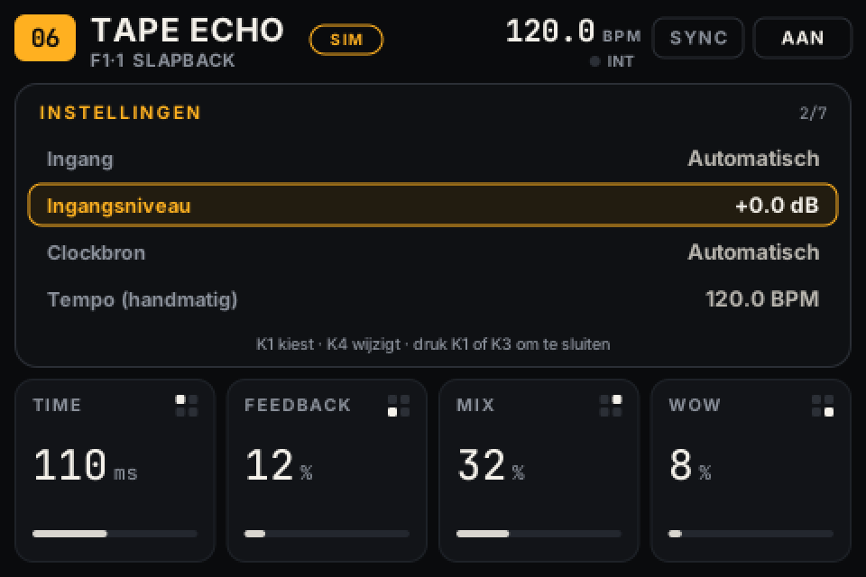

# FXBox — handleiding

[English](MANUAL.md) · **Nederlands**

Aanzetten, instrument aansluiten, preset kiezen en spelen. Deze handleiding beschrijft de installatie, de bediening en wat je doet als er iets misgaat.

## 1. Wat je nodig hebt

- Zynthian Kit V4 met Raspberry Pi 4, ZynScreen, ZynADAC (of HiFiBerry DAC+ ADC Pro)
- Een microSD-kaart van minstens 8 GB, die **gewist wordt**
- Een computer met Raspberry Pi Imager en een netwerk (alleen voor de installatie)

## 2. SD-kaart voorbereiden

> **Let op:** Raspberry Pi Imager wist de gekozen kaart volledig. Kies de juiste kaart; FXBox schrijft zelf nooit naar een kaart.

1. Open Raspberry Pi Imager → *Raspberry Pi 4* → *Raspberry Pi OS (other)* → **Raspberry Pi OS Lite (64-bit)** (Bookworm).
2. Bij *Instellingen bewerken*: hostnaam `fxbox`, een gebruiker met wachtwoord, **SSH aan**, eventueel wifi.
3. Schrijf de kaart, zet ze in de Pi en start het toestel. Het ZynScreen blijft voorlopig wit of zwart; dat is normaal.

## 3. Installeren

Kopieer het zip-bestand naar de Pi en installeer (vanaf je computer):

```bash
scp fxbox-1.2.0.zip GEBRUIKER@fxbox.local:
ssh GEBRUIKER@fxbox.local
unzip fxbox-1.2.0.zip && cd fxbox
sudo ./install/install.sh
sudo reboot
```

Het script installeert de pakketten, bouwt de audio-engine en voert op de Pi zelf de engine- en interfacetests uit. Voordat het de opstartconfiguratie wijzigt, vraagt het om bevestiging; van `config.txt` en `cmdline.txt` blijft een reservekopie staan. Dat duurt even, want pakketten worden gedownload en de engine wordt op de Pi gecompileerd.

Na de herstart start het toestel rechtstreeks in de effectinterface.

### 3b. Alternatief: kant-en-klaar image bouwen

Met `install/build-image.sh` bouw je op een Linux-pc (Debian/Ubuntu) een `.img`-bestand waarin FXBox al geïnstalleerd is. Dat zet je daarna gewoon op een kaart, en installeren op de Pi zelf is dan niet meer nodig.

```bash
sudo apt install curl xz-utils parted e2fsprogs openssl rsync qemu-user-static binfmt-support
sudo ./install/build-image.sh --user GEBRUIKER --hostname fxbox --xz
```

- Het script downloadt de nieuwste Raspberry Pi OS Lite 64-bit "oldstable" (Bookworm) en controleert de SHA-256.
- Met `--base BESTAND` gebruik je een image dat je zelf al gedownload hebt.
- Het installatiescript draait daarna in ARM64-emulatie, inclusief alle tests. Reken op een lange build, want onder emulatie compileert de engine traag.
- Het resultaat komt in `image-out/`: `fxbox-<versie>-<datum>.img` (plus `.xz` en `.sha256`), samen met het installatielog.
- Gebruiker, wachtwoord (gehasht), SSH en hostnaam zitten al in het image.
- Schrijf het image met Raspberry Pi Imager → *Use custom* en sla daar de *OS customisation* over.
- Bij de eerste start vergroot Raspberry Pi OS het bestandssysteem en herstart het één keer. Doe daarna de controle van stap 4.
- Het script maakt alleen een bestand en schrijft nooit zelf naar een SD-kaart.
- Is de "oldstable"-download intussen geen Bookworm meer, dan stopt het script. Geef dan een Bookworm-image op met `--base`, of bouw bewust met `--allow-trixie`.

## 4. Eerste controle (eenmalig)

```bash
sudo fxbox-hwtest check            # zijn scherm, bediening, geluidskaart en MIDI-UART er?
sudo systemctl stop fxbox-ui
sudo fxbox-hwtest screen           # testbeeld: rand rondom zichtbaar, tekst rechtop
sudo fxbox-hwtest controls --write # druk S1..S4, druk en draai K1..K4 zoals gevraagd
sudo systemctl start fxbox-ui
sudo ./install/measure-latency.sh  # optioneel: kabel van UIT L naar IN L, meet de vertraging
```

`controls --write` legt de gemeten koppeling van de knoppen vast in `/etc/fxbox/hardware.toml`.

## 5. Aansluiten

Instrument → **IN L** (mono) of **IN L + R** (stereo) → effect → **UIT L + R**.

- De ingang verwacht **lijnniveau** (synth, drumcomputer, mengpaneel).
- Voor een gitaar of bas: gebruik een DI-box of een buffer-/effectpedaal ervoor. De ingang is niet hoogohmig.
- Mono-in naar stereo-uit gaat vanzelf: staat *Instellingen → Ingang* op **Automatisch** (standaard), dan ziet FXBox dat IN R stil is en stuurt het linkerkanaal naar beide kanten. Beide VU-meters slaan dan uit en de rechtermeter toont **R=L**. Je kunt de ingang ook vast op *Stereo* of *Mono (L)* zetten.
- Lichten **IN CLIP** of **CLIP** op, verlaag dan het niveau van je instrument of *Instellingen → Ingangsniveau*.

## 6. Bediening

### De effectketen

FXBox werkt als een pedalboard met acht effecten in een vaste volgorde. Elk effect staat aan of uit:

**01 Filter → 02 Saturation → 03 Distortion → 04 Chorus → 05 Phaser → 06 Tape Echo → 07 Reverb → 08 Compressor**

- De balk boven de meters toont de keten. Effecten die **aan** staan zijn amber, effecten die uit staan zijn grijs. Het effect met de witte rand staat op het scherm: de vier tegels en de knoppen horen bij dát effect.
- Effecten die uit staan kosten geen rekenkracht.
- Staat de compressor aan, dan toont zijn vakje hoeveel hij het niveau op dat moment terugregelt (bijvoorbeeld *−4 dB*). De donkere vulling groeit mee, tot 20 dB.



### Knoppen

De vier tegels onderaan horen bij de vier draaiknoppen. Het kleine 2×2-symbool rechtsboven op een tegel toont welke knop dat is.

| Knop | Draaien | Kort indrukken | Ingedrukt houden (0,8 s) |
|---|---|---|---|
| **K1** linksboven | parameter 1 | **ketenscherm**: kies met K1 een effect, K2 zet het aan/uit, K1 toont het | **opslaan** als gebruikerspreset |
| **K2** linksonder | parameter 2 | getoond effect **aan/uit** | **bypass** van de hele keten |
| **K3** rechtsboven | parameter 3 | **sync** aan/uit | **instellingen** |
| **K4** rechtsonder | parameter 4 | **tap tempo** | **pagina 1 / pagina 2** van het getoonde effect |
| **S1 / S2** | | vorige / volgende preset | |
| **S3 / S4** | | vorige / volgende bank | |

- Draaien regelt tijdens het spelen altijd de bijbehorende parameter van het getoonde effect. Snel draaien maakt grotere stappen.
- Een knop die je indrukt verandert geen parameter, ook niet als hij een klein beetje meedraait.
- Tap tempo reageert meteen bij het indrukken. K2 reageert bij loslaten, zodat kort (effect aan/uit) en lang (hele keten bypass) uit elkaar te houden zijn.
- Staat het getoonde effect uit, dan staat **UIT** naast de naam. Je kunt de instellingen dan al aanpassen voordat je het effect aanzet.
- In een keuzescherm sluit of annuleert een druk op S1–S4.
- **Pagina 2:** Filter, Distortion en Compressor hebben een tweede rij van vier instellingen. Houd **K4** ingedrukt om te wisselen; in de kopregel staat dan **PAG 2** (amber). Kies je een ander effect of een andere preset, dan sta je weer op pagina 1. Effecten zonder tweede pagina melden *Geen pagina 2*. Omdat K4 bij indrukken ook een tap geeft, telt die ene tap pas mee als je binnen 2 seconden opnieuw tapt.
- **Keuzeparameters** zoals TYPE en LFO VORM gaan één stap per klik, hoe snel je ook draait.



| Effect | K1 | K2 | K3 | K4 |
|---|---|---|---|---|
| 01 Filter | Cutoff | Reso | LFO Rate | LFO Diepte |
| 01 Filter, pagina 2 | Type | LFO Vorm | Envelope | Drive |
| 02 Saturation | Drive | Warmte | Mix | Level |
| 03 Distortion | Drive | Tone | Mix | Level |
| 03 Distortion, pagina 2 | Type | Crush | Gate | — |
| 04 Chorus | Rate | Depth | Mix | Feedback |
| 05 Phaser | Rate | Depth | Mix | Feedback |
| 06 Tape Echo | Time | Feedback | Mix | Wow |
| 07 Reverb | Decay | Tone | Mix | Predelay |
| 08 Compressor | Drempel | Ratio | Attack | Make-up |
| 08 Compressor, pagina 2 | Release | Knee | Mix | Limiter |

- **Filter:**
  - *Type:* **Ladder LP** (4-polig, Moog-stijl, zoals in versie 1.1), **Low-pass**, **High-pass**, **Band-pass** en **Notch** (12 dB/octaaf, state-variable). Wisselen gaat met een korte overvloeiing, zonder klik.
  - *LFO:* beweegt de cutoff tot 3 octaven op en neer en volgt het tempo als sync aan staat. *LFO Vorm:* sinus, driehoek, blok of random (sample & hold, een nieuwe waarde per LFO-periode).
  - *Envelope:* hoe harder je speelt, hoe hoger de cutoff (tot 4 octaven): een auto-wah. Probeer Band-pass met Envelope rond 80 %.
  - *Drive:* overstuurt het signaal licht vóór het filter (tot 18 dB, met volumecompensatie).
- **Saturation:** warme band- of buisachtige verzadiging. Meer Drive geeft meer boventonen en compressie, maar het volume blijft ongeveer gelijk. Warmte voegt even boventonen toe en dempt het hoog een beetje.
- **Distortion:**
  - *Type:* **Overdrive** (zacht, zoals in versie 1.1), **Distortion** (harde clipping), **Fuzz**, **Bitcrush** en **Folder** (wavefolder: het signaal vouwt terug in plaats van af te kappen, metalig en synthachtig).
  - Met Mix onder 100 % meng je het droge signaal erbij (parallelle distortion). Level regelt het uitgangsvolume van het effect.
  - *Crush* werkt alleen bij Bitcrush: minder bits en een lagere samplerate.
  - *Gate* is een noise gate vóór de vervorming, handig bij Fuzz om geruis tussen noten weg te houden. Op 0 % staat hij uit.
  - De Distortion rekent intern op dubbele samplerate (2× oversampling). Dat geeft minder aliasing, een schurend bijgeluid bij hoge tonen. Het kost wel meer rekenkracht en voegt 23 samples (0,5 ms) vertraging toe, maar alleen zolang de Distortion aan staat.
- **Compressor:** staat altijd als laatste in de keten en houdt het eindniveau onder controle.
  - *Drempel:* vanaf welk niveau (dBFS) hij terugregelt. *Ratio:* hoe sterk (4:1 betekent: 4 dB erbij boven de drempel geeft 1 dB erbij aan de uitgang). *Attack* en *Release:* hoe snel hij reageert en loslaat. *Knee:* hoe geleidelijk de overgang rond de drempel is. *Make-up:* versterking achteraf.
  - *Mix* onder 100 % geeft parallelle compressie: het ongecomprimeerde signaal blijft erbij.
  - *Limiter* (standaard **aan**) is een snelle begrenzer na de compressor die de uitgang onder ongeveer −1 dBFS houdt, ook met veel make-up. Hij werkt alleen als de compressor aan staat.

## 7. Het scherm



- **Linksboven:** effectnummer en effectnaam, daaronder bank·preset en de presetnaam. Een amberkleurig puntje betekent dat je de preset hebt aangepast maar nog niet opgeslagen.
- **Rechtsboven:** tempo in BPM met de bron eronder.
  - *MIDI DIN* of *MIDI USB*, met een licht puntje, wil zeggen dat er echt clock binnenkomt.
  - *TAP* of *INT* betekent handmatig tempo.
  - Verder **SYNC** (amber = aan) en **AAN/BYPASS**.
- **Meters:** de naalden tonen het uitgangsniveau op een **relatieve VU-schaal**; linksboven staat welk digitaal niveau 0 VU is. **PEAK** is de digitale piek in **dBFS** (0 dBFS is het maximum van de converter). **CLIP** licht op als de uitgang de volle schaal raakt.
- **Tegels:** naam, waarde, eenheid en een balkje. De laatst bediende parameter licht amber op. Met sync aan toont een tijd- of snelheidsparameter een verdeling, zoals 1/8D, met de berekende waarde eronder.



## 8. Presets

- **7 fabrieksbanken:** F1 Basis, F2 Dub & Space, F3 Ambient, F4 Modulatie, F5 Drive & Filter en F6 Ketens (meerdere effecten tegelijk) met elk 6 presets, en F7 Karakter met 8 presets voor de filter- en distortiontypes en de compressor (Auto-wah, HP wobble, Sample & hold, Lo-fi crush, Wavefolder, Gated fuzz, Glue, Parallel squash). Fabriekspresets kun je niet overschrijven.
- Presets en de toestand uit versie 1.1 blijven werken. Waar instellingen van pagina 2 ontbreken, gelden de standaardwaarden, die klinken zoals in 1.1 (Ladder-filter, Overdrive).
- Een preset bewaart de hele keten: welke effecten aan staan, hun instellingen en welk effect op het scherm staat.
- **Opslaan:** houd K1 ingedrukt. Kies met K1 een plaats in de gebruikersbanken U1–U4 (8 plaatsen per bank) en druk K1 om op te slaan. Annuleren doe je met K3 of S1–S4. Was je al een gebruikerspreset aan het bewerken, dan staat die plaats voorgeselecteerd, dus opnieuw opslaan is: K1 vasthouden, daarna K1 drukken.
- Gebruikersbanken verschijnen in de bankkeuze zodra ze minstens één preset bevatten.
- Het toestel onthoudt de keten (aan/uit en alle waarden), het getoonde effect, preset, bank, sync, bypass en instellingen, en start na het inschakelen in dezelfde toestand.
- Wijzigingen worden 2 seconden nadat je stopt met draaien opgeslagen. Zet het toestel daarom niet uit binnen 2 seconden na een wijziging die je wilt bewaren.







## 9. Tempo en MIDI-sync

- **Sync uit:** Time staat in ms en Rate in Hz. **Tap** (K4) zet de Time van de Tape Echo op één kwartnoot van het getapte tempo.
- **Sync aan:** Time en Rate volgen het tempo, met verdelingen 1/32 … 1/1 voor delay en 1/16 … 8/1 voor modulatie (D = gepunt, T = triool).
- **Tempobron:**
  - Komt er MIDI-clock binnen (DIN of USB), dan volgt FXBox die.
  - Anders geldt het getapte of handmatige tempo (*Instellingen → Tempo*).
- **Clock valt weg:** het laatste tempo blijft staan en het puntje bij de bron dooft.
- **MIDI Start:** Chorus en Phaser beginnen hun beweging op tel 1. **Stop** en **Continue** laten het geluid ongemoeid.
- **Meerdere MIDI-apparaten:** kies de bron in *Instellingen → Clockbron*.

## 10. Instellingen (K3 ingedrukt houden)

Draai **K1** om een onderdeel te kiezen en **K4** om de waarde te wijzigen. Druk **K1** of **K3** om te sluiten.

| Onderdeel | Keuzes |
|---|---|
| Ingang | Automatisch / Stereo / Mono (L) |
| Ingangsniveau | −12 … +12 dB (digitaal) |
| Clockbron | Automatisch / DIN-MIDI / USB-apparaat |
| Tempo (handmatig) | 30 … 300 BPM |
| Staarten bij bypass | Aan: echo en galm klinken uit als je een effect of de hele keten uitzet. Uit: meteen stil. |
| VU-referentie | 0 VU = −12 / −14 / −18 / −20 dBFS |
| Info | samplerate, buffergrootte, aantal xruns, DSP-belasting |



## 11. Problemen oplossen en herstel

| Melding op het scherm | Wat te doen |
|---|---|
| *Geen audio-interface gevonden* | Toestel uit. Controleer of de geluidskaart goed op de pinnen van de Pi zit. Het toestel blijft opnieuw proberen. |
| *Audioserver niet actief* / *Audio onderbroken* | Wordt automatisch herstart. Blijft de melding staan, voer `sudo systemctl status fxbox-jack` uit. |
| *Audio-engine niet bereikbaar* | Na 10 crashes in 2 minuten stopt het automatisch herstarten. Voer `sudo systemctl restart fxbox-engine` uit en bekijk `journalctl -u fxbox-engine -b`. |
| *Bediening niet gevonden (I²C 0x20)* | Het scherm werkt, de knoppen niet. Controleer de verbinding van de ZynScreen-print. Voer `sudo fxbox-hwtest check` uit. |
| Knop draait de verkeerde kant op of S1–S4 in de verkeerde volgorde | `sudo fxbox-hwtest controls --write`, of `reverse` aanpassen in `/etc/fxbox/hardware.toml`. |
| Kraakjes | *Instellingen → Info*: loopt het aantal xruns op? Zet `PERIOD=256` in `/etc/fxbox/audio.conf` en voer `sudo systemctl restart fxbox-jack fxbox-engine` uit. |
| Scherm blijft wit of zwart | Voer `sudo fxbox-hwtest screen` uit en daarna `dmesg | grep -i -E "fb|ili"`. Staat het FXBox-blok in `/boot/firmware/config.txt`? |

**Onderhoud via SSH.** Het toestel draait zonder desktop. Je kunt altijd inloggen met `ssh GEBRUIKER@fxbox.local`. De tekstconsole is bewust van alle schermen losgekoppeld, ook van HDMI, zodat er nooit een login of opstarttekst op het ZynScreen verschijnt.

- Logboeken: `journalctl -u fxbox-ui -u fxbox-engine -u fxbox-jack -b`. Die staan in het werkgeheugen en zijn na een herstart weg.
- **Instellingen terug naar standaard:** `sudo systemctl stop fxbox-ui && sudo rm /var/lib/fxbox/state.json && sudo systemctl start fxbox-ui`.
- **Gebruikerspresets wissen:** `/var/lib/fxbox/user_presets.json` verwijderen. Maak eerst een kopie als je ze wilt bewaren.
- **Bijwerken:** pak een nieuwe versie uit en voer `sudo ./install/install.sh` opnieuw uit. Je hardware- en audio-instellingen en je presets blijven behouden.
- **Verwijderen:** `sudo ./install/uninstall.sh` herstelt de opstartconfiguratie. Gebruik `--purge` om ook presets en instellingen te wissen.
